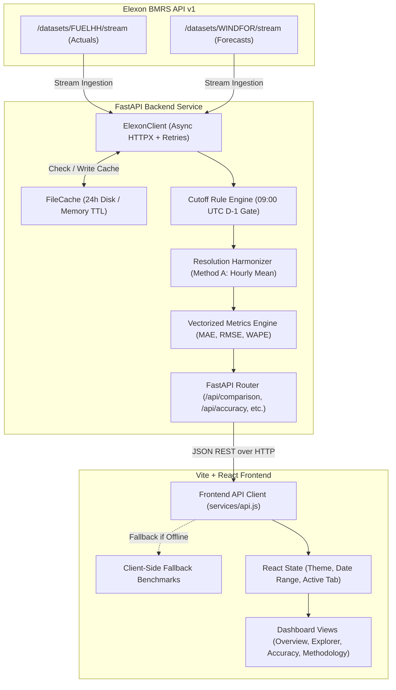

# UK Wind Power Forecasting & Accuracy Analytics Dashboard

> **Day-Ahead Purchasing Operations • GB Electricity Grid Analytics**  
> Operational analytics platform and high-performance REST API built for an energy utility's day-ahead power trading desk. Evaluates Great Britain (GB) national wind generation forecasts against settlement outturns across January 2026, enforcing realistic exchange gate-closure decision rules.

---

## 1. Business Objective

In the GB wholesale electricity market, day-ahead power purchasing desks must contract sufficient generation to meet forecasted physical consumer demand prior to power exchange gate closures:
- **Exchange Auction Freeze**: EPEX SPOT GB Day-Ahead auction order books close at **09:20 UK local time** (09:20 UTC during winter/January).
- **Physical Decision Gate**: Power trading desks must freeze their physical generation expectations at or before **09:00 UTC on D-1** (20 minutes prior to exchange order book submission) to aggregate portfolio positions, formulate supply/demand curves, and submit cleared orders.
- **The Core Problem**: National wind generation forecasts are continuously republished by National Grid ESO / NESO throughout the day. Using intraday or post-cutoff forecast revisions introduces severe look-ahead bias and misrepresents the actual risk profile faced by the trading desk at auction closure.

This platform provides:
1. **Automated Elexon BMRS Ingestion**: Ingestion of metered settlement outturns (`FUELHH`) and published wind forecasts (`WINDFOR`).
2. **Deterministic Day-Ahead Cutoff Engine**: Strictly isolates the latest forecast revision available before **09:00 UTC on D-1**, rejecting all post-cutoff runs.
3. **Multi-Resolution Settlement Harmonization**: Harmonizes 30-minute metered outturns to hourly forecast cadences via two-period mean aggregation (Method A) and point-sampling (Method B).
4. **Accuracy Benchmarking Suite**: Computes Mean Absolute Error (MAE), Root Mean Squared Error (RMSE), Mean Error / Bias ($F - A$), Mean Absolute Percentage Error (MAPE), and Weighted Absolute Percentage Error (WAPE).
5. **Interactive Trading Dashboard**: 4 operational views equipped with dynamic date filtering, single-interval audit history, and customizable Light/Dark theme switching.

---

## 2. Features

### 2.1. View 1: Executive Overview Tab
- **Executive Metric Cards**: Average Actual Outturn (MW), Average Day-Ahead Forecast (MW), MAE, RMSE, Mean Error / Bias, and Matched Hourly Intervals.
- **Interactive Time Series Chart**: Recharts dual-line visualization comparing selected Day-Ahead forecasts against metered outturn, equipped with responsive tooltips and zoom capabilities.
- **Date & Cutoff Controls**: Select custom date ranges and adjust cutoff hours (`09:00`, `12:00`, `17:00`) with dynamic period loading feedback.
- **Commercial Scope Callout**: Clarifies physical wind generation forecast deviation versus commercial portfolio shortfall.

```markdown

*Placeholder: Executive Overview Tab displaying KPI cards, interactive date controls, and hourly outturn vs forecast time-series.*
```

### 2.2. View 2: Forecast Explorer Tab
- **Single-Interval Deep-Dive Audit**: Inspect any delivery hour in January 2026 to see all published forecast revisions leading up to delivery.
- **Revision Trajectory Step Chart**: Visualizes forecast evolution across publication lead times, highlighting the 09:00 UTC D-1 decision cutoff line.
- **Audit Table**: Chronological table showing publish timestamps, lead times, predicted generation, and status badges (`Selected Day-Ahead Forecast`, `Before Cutoff`, `Post-Cutoff / Excluded`).

```markdown

*Placeholder: Forecast Explorer Tab displaying revision trajectory step chart and chronological audit table.*
```

### 2.3. View 3: Accuracy Analysis Tab
- **Daily Performance Breakdown**: Dual-bar chart detailing daily MAE and RMSE across every delivery day.
- **Continuous Error Time Series ($F - A$)**: Visualizes over-forecasting spikes vs under-forecasting troughs with a reference zero line.
- **Top 10 Largest Forecast Error Hours**: Rank-ordered table identifying the most severe forecast misses, their absolute errors, and percentage deviations.

```markdown

*Placeholder: Accuracy Analysis Tab showing daily MAE/RMSE bar chart, error time-series, and Top 10 largest error hours.*
```

### 2.4. View 4: Data & Methodology Tab
- **Paginated Settlement Audit Table**: 20 records per page covering all 744 intervals in January 2026 with lead times, cutoff deadlines, and errors.
- **Mathematical Formulations**: Direct documentation of metric formulas, units, and aggregation methodologies.
- **Commercial Scope Clarification**: BSC Section T imbalance settlement rules and cashout price mechanics.

```markdown

*Placeholder: Methodology Tab showing paginated verification table and commercial formula documentation.*
```

### 2.5. Theme Customization (Light & Dark Mode)
- **High-Contrast Light Theme (Default)**: Modern slate and radial gradient palette designed for trading floor readability.
- **Dark Mode**: Sleek dark slate theme with glowing neon accents.
- **One-Click Header Toggle**: Header toggle button with Moon/Sun icons, persistent in `localStorage` across page reloads.

```markdown

*Placeholder: Theme customization toggle demonstrating seamless Light Mode and Dark Mode switching.*
```

---

## 3. Tech Stack

| Domain | Technology | Version | Purpose |
| :--- | :--- | :--- | :--- |
| **Backend Framework** | **FastAPI** | `^0.115.0` | High-performance async ASGI REST API |
| **Server Engine** | **Uvicorn** | `^0.32.0` | Production ASGI web server |
| **Data Processing** | **Pandas** | `^2.2.0` | Vectorized data harmonization and error metrics |
| **HTTP Client** | **HTTPX** | `^0.28.0` | Async HTTP client with exponential backoff retries |
| **Schema Validation** | **Pydantic v2** | `^2.10.0` | Strict data validation and OpenAPI schema generation |
| **Backend Testing** | **Pytest** | `^9.1.0` | Test runner with `pytest-asyncio` / `anyio` |
| **Frontend Framework**| **React** | `^18.3.1` | Component-based reactive user interface |
| **Build Tool & Bundler**| **Vite** | `^6.2.0` | Modern, lightning-fast web bundler |
| **Data Visualization**| **Recharts** | `^2.15.0` | Interactive SVG charting library |
| **Icons** | **Lucide React** | `^0.475.0` | Modern UI icon library |
| **Frontend Testing** | **Vitest** | `^5.0.5` | Unit testing with `@testing-library/react` |
| **Containerization** | **Docker** | Multi-stage | Isolated container images for backend and frontend |
| **Orchestration** | **Docker Compose** | Compose v2 | Multi-container local execution |
| **Reverse Proxy** | **Nginx** | Alpine | High-efficiency static SPA delivery in production |

---

## 4. Architecture and Data Flow



### Data Processing Pipeline
1. **Ingestion & Buffering**: `ElexonClient` fetches raw JSON streams from Elexon BMRS API v1. To avoid boundary truncation on the first day of the target month, a **4-day lookback buffer** is automatically prepended to the forecast query window.
2. **Caching**: Raw responses are saved to disk with a 24-hour TTL, preventing rate limiting and ensuring sub-second response times.
3. **Cutoff Decision Filtering**: For each delivery hour $t$, candidate forecasts are filtered to keep only runs published at or before `09:00 UTC on D-1`. The latest pre-cutoff run is selected; post-cutoff runs are disqualified.
4. **Resolution Harmonization**: 30-minute metered outturns (`FUELHH`) are averaged into 60-minute intervals matching the hourly forecast cadence (`WINDFOR`).
5. **Vectorized Metrics Engine**: Pandas calculates absolute errors, quadratic errors, volume-weighted deviations, and daily distributions.
6. **REST API Delivery**: Pydantic models validate and serialize responses for the React dashboard.

---

## 5. Elexon Data Sources

The platform queries two public stream datasets from the Elexon BMRS API v1:

### 5.1. `FUELHH` (Half-Hourly Generation by Fuel Type)
- **Endpoint**: `https://data.elexon.co.uk/bmrs/api/v1/datasets/FUELHH/stream`
- **Cadence**: 30-minute settlement periods (48 periods per calendar day).
- **Filtering**: Filtered strictly for `fuelType == "WIND"`.
- **Query Strategy**: Queried via `settlementDateFrom` and `settlementDateTo` to ensure Settlement Period 48 is never truncated by clock offsets.
- **Fields Utilized**: `startTime` (UTC settlement start), `settlementDate`, `settlementPeriod`, `generation` (MW), `fuelType`.

### 5.2. `WINDFOR` (Wind Generation Forecast)
- **Endpoint**: `https://data.elexon.co.uk/bmrs/api/v1/datasets/WINDFOR/stream`
- **Cadence**: Published multiple times daily at an hourly cadence (`:00` minutes).
- **Lookahead Horizon**: Generates predictions for up to ~66.5 hours ahead of publication.
- **Query Strategy**: Queried via UTC datetime boundaries (`publishDateTimeFrom` and `publishDateTimeTo`).
- **Fields Utilized**: `publishTime` (UTC publication timestamp), `startTime` (UTC target delivery hour), `generation` (forecasted MW).

---

## 6. Forecast-Selection and Decision-Cutoff Methodology

### 6.1. Market Timing & Cutoff Justification
- **Market Gate Closure**: The EPEX SPOT GB Day-Ahead wholesale power auction closes its order book at **09:20 UK local time**.
- **Trading Desk Decision Freeze**: To aggregate positions, run credit checks, and formulate bids, trading desks freeze physical generation forecasts at **09:00 UTC on D-1**.
- **Formal Selection Rule**: For a target delivery interval $t$ occurring on delivery date $D$:
  $$\text{Cutoff Datetime} = (\text{Date}(t) - 1\text{ day})\text{ at }09:00:00\text{ UTC}$$
  $$\text{Selected Forecast} = \arg\max_{f \in \mathcal{F}(t)} \{ \text{publishTime}(f) \mid \text{publishTime}(f) \le \text{Cutoff Datetime} \}$$
  Where $\mathcal{F}(t)$ is the set of all forecasts published with target start time $t$. Any forecast with $\text{publishTime} > \text{Cutoff Datetime}$ is strictly excluded.

### 6.2. Concrete Worked Example
Consider a target delivery hour of **Thursday, 15 January 2026 at 14:00 UTC** ($D = \text{2026-01-15}$):
- **Decision Cutoff Deadline**: Wednesday, 14 January 2026 at **09:00:00 UTC** ($D-1$ at 09:00 UTC).

| Candidate Run | Published Timestamp (UTC) | Predicted Generation | Status Under 09:00 D-1 Rule | Explanation |
| :--- | :--- | :--- | :--- | :--- |
| **Run 1** | `2026-01-13 18:00:00` | 9,450 MW | Superseded | Published before cutoff, but superseded by newer pre-cutoff runs. |
| **Run 2** | `2026-01-14 06:00:00` | 10,200 MW | Superseded | Published before cutoff, but superseded by Run 3. |
| **Run 3** | `2026-01-14 08:30:00` | **11,150 MW** | **SELECTED** | **Latest publication at or before 09:00 UTC D-1.** |
| **Run 4** | `2026-01-14 11:00:00` | 11,900 MW | Excluded | Post-cutoff (published after 09:00 UTC D-1 decision freeze). |
| **Run 5** | `2026-01-15 08:00:00` | 12,400 MW | Excluded | Intraday publication (only 6h lead time; unavailable at Day-Ahead auction). |

- **Actual Metered Outturn (`FUELHH`)**: `9,820 MW`
- **Lead Time**: $14:00 - 08:30 = \mathbf{29.5\text{ hours}}$ (Nominal lead time from decision freeze: $14:00 - 09:00 = 29.0\text{ hours}$).
- **Forecast Error ($F - A$)**: $11,150 - 9,820 = \mathbf{+1,330\text{ MW}}$ (Over-forecast).

---

## 7. Metric Definitions & Formulas

All generation and absolute error metrics are reported in **Megawatts (MW)**; relative error metrics are reported in **Percentage (%)**.

| Metric | Formula | Units | Description & Operational Purpose |
| :--- | :--- | :---: | :--- |
| **Mean Absolute Error (MAE)** | $$\text{MAE} = \frac{1}{N} \sum_{i=1}^{N} \|F_i - A_i\|$$ | MW | Average magnitude of forecast error regardless of direction. Primary metric for sizing reserve capacity. |
| **Root Mean Squared Error (RMSE)** | $$\text{RMSE} = \sqrt{\frac{1}{N} \sum_{i=1}^{N} (F_i - A_i)^2}$$ | MW | Quadratic error penalizing large outlier forecast misses. Critical for assessing extreme imbalance risks. |
| **Mean Error (Bias)** | $$\text{Mean Error} = \frac{1}{N} \sum_{i=1}^{N} (F_i - A_i)$$ | MW | Directional bias. Positive values ($> 0$) indicate systemic over-forecasting; negative ($< 0$) indicate under-forecasting. |
| **Mean Absolute Percentage Error (MAPE)** | $$\text{MAPE} = \frac{100\%}{N_{\text{valid}}} \sum_{i: A_i > 0} \frac{\|F_i - A_i\|}{A_i}$$ | % | Relative error percentage. Intervals with $A_i = 0$ are excluded to prevent division by zero. |
| **Weighted Absolute Percentage Error (WAPE)** | $$\text{WAPE} = \frac{\sum_{i=1}^{N} \|F_i - A_i\|}{\sum_{i=1}^{N} A_i} \times 100\%$$ | % | Volume-weighted error. Avoids small-denominator distortion and handles zero-generation intervals cleanly. |

### January 2026 Full-Month Benchmark Results ($N = 744$ Hours)
- **Average Actual Generation**: `11,577.63 MW`
- **Average Day-Ahead Forecast**: `13,429.53 MW`
- **MAE**: `2,142.12 MW`
- **RMSE**: `2,611.70 MW`
- **Mean Error (Bias)**: **`+1,851.90 MW`** (Substantial over-forecasting)
- **MAPE**: `22.38%`
- **WAPE**: `18.50%`

---

## 8. Folder Structure

```
wind-forecast-dashboard/
├── .env.example                # Sample environment configuration file
├── .gitignore                  # Git ignore rules (node_modules, caches, virtualenvs)
├── .dockerignore               # Root Docker build ignore patterns
├── docker-compose.yml          # Multi-container orchestration (Backend + Frontend)
├── package.json                # Root package configuration for workspaces/Vercel
├── pytest.ini                  # Pytest runner configuration
├── README.md                   # Project documentation and operational guide
├── backend/                    # FastAPI Backend Service
│   ├── .dockerignore
│   ├── Dockerfile              # Multi-stage production container build for backend
│   ├── requirements.txt        # Python backend dependencies
│   ├── vercel.json             # Vercel serverless function configuration (@vercel/python)
│   ├── main.py                 # FastAPI application, CORS, routers & exception handlers
│   ├── models.py               # Pydantic v2 schemas for request/response validation
│   ├── api/
│   │   └── index.py            # Serverless ASGI entrypoint for Vercel
│   ├── services/
│   │   ├── __init__.py
│   │   ├── elexon.py           # Async Elexon BMRS client with exponential backoff retries
│   │   ├── forecast.py         # Cutoff filtering, resolution aggregation & lead-time engine
│   │   ├── metrics.py          # Vectorized accuracy calculations (MAE, RMSE, MAPE, WAPE)
│   │   └── cache.py            # Multi-directory file cache with TTL and memory fallback
│   └── tests/
│       ├── __init__.py
│       ├── test_api.py         # FastAPI TestClient endpoint validation tests
│       ├── test_elexon.py      # Elexon HTTP client retry and error handling tests
│       ├── test_forecast.py    # Cutoff rules, lead-time profiles & aggregation tests
│       └── test_metrics.py     # Accuracy formulas, bias & edge case unit tests
├── frontend/                   # Vite + React Frontend Application
│   ├── .dockerignore
│   ├── Dockerfile              # Multi-stage container build (Vite build + Nginx Alpine)
│   ├── nginx.conf              # Nginx production web server & SPA fallback configuration
│   ├── package.json            # Frontend dependencies & scripts
│   ├── vite.config.js          # Vite configuration with React plugin & proxy rules
│   ├── index.html              # HTML5 entrypoint with SEO meta tags
│   ├── src/
│   │   ├── main.jsx            # React root application bootstrap
│   │   ├── App.jsx             # Top-level state management (theme, filters, active tab)
│   │   ├── index.css           # Vanilla CSS design system with light/dark tokens
│   │   ├── components/
│   │   │   ├── Header.jsx      # Top navigation, live badges & theme toggle button
│   │   │   ├── DateControls.jsx# Date pickers, cutoff selectors & refresh button
│   │   │   └── MetricCard.jsx  # Reusable KPI card with trend accents and icons
│   │   ├── pages/
│   │   │   ├── OverviewTab.jsx         # View 1: KPI cards, time-series chart & scope banner
│   │   │   ├── ForecastExplorerTab.jsx # View 2: Revision step chart & single interval audit
│   │   │   ├── AccuracyTab.jsx         # View 3: Daily MAE/RMSE bars & Top 10 misses table
│   │   │   └── MethodologyTab.jsx      # View 4: Settlement verification audit table
│   │   ├── services/
│   │   │   └── api.js          # Axios/Fetch wrapper with offline benchmark fallback
│   │   ├── data/               # Embedded January 2026 benchmark datasets for offline fallback
│   │   │   ├── accuracy.json
│   │   │   ├── comparison.json
│   │   │   ├── daily_accuracy.json
│   │   │   ├── explorer_presets.json
│   │   │   └── methodology.json
│   │   └── __tests__/
│   │       └── dashboard_states.test.jsx # Vitest suite for UI states & theme switcher
└── scripts/
    └── explore_elexon.py       # Standalone CLI exploratory script for BMRS inspection
```

---

## 9. Local Setup

### Prerequisites
- **Python**: Version `3.11` or higher
- **Node.js**: Version `18.0.0` or higher (with `npm`)

### 9.1. Backend Setup
1. Navigate to the backend directory and create a virtual environment:
   ```bash
   cd backend
   python -m venv .venv
   ```
2. Activate the virtual environment:
   - **Windows (PowerShell)**:
     ```powershell
     .\.venv\Scripts\Activate.ps1
     ```
   - **macOS / Linux**:
     ```bash
     source .venv/bin/activate
     ```
3. Install dependencies:
   ```bash
   pip install -r requirements.txt
   ```
4. Start the FastAPI development server:
   ```bash
   uvicorn main:app --host 127.0.0.1 --port 8000 --reload
   ```
   The backend API will be running at `http://127.0.0.1:8000`.  
   Interactive Swagger documentation is available at `http://127.0.0.1:8000/docs`.

### 9.2. Frontend Setup
1. Open a new terminal and navigate to the frontend directory:
   ```bash
   cd frontend
   ```
2. Install frontend packages:
   ```bash
   npm install
   ```
3. Start the Vite development server:
   ```bash
   npm run dev
   ```
   The application dashboard will be accessible at `http://localhost:5173`.

---

## 10. Docker Setup

Both the backend and frontend can be spun up simultaneously with a single command via Docker Compose.

### 10.1. Build and Run Containers
```bash
docker compose up --build
```

### 10.2. Service URLs
- **Frontend Dashboard**: `http://localhost:3000`
- **Backend REST API**: `http://localhost:8000`
- **Interactive API Documentation (Swagger)**: `http://localhost:8000/docs`
- **API Health Check**: `http://localhost:8000/api/health`

### 10.3. Stop Containers
To stop the running containers:
```bash
docker compose down
```
To stop and remove associated volumes:
```bash
docker compose down -v
```

---

## 11. Deployed Application Links

- **Frontend Application (Vercel)**: `https://reint-ai-frontend.vercel.app` *(Placeholder / Deployed link)*
- **Live Backend REST API**: [`https://r-eint-ai-m3z1.vercel.app`](https://r-eint-ai-m3z1.vercel.app)
- **Live Swagger API Documentation**: [`https://r-eint-ai-m3z1.vercel.app/docs`](https://r-eint-ai-m3z1.vercel.app/docs)
- **Live Health Endpoint**: [`https://r-eint-ai-m3z1.vercel.app/api/health`](https://r-eint-ai-m3z1.vercel.app/api/health)

---

## 12. Testing Instructions

The repository contains automated test suites for both backend and frontend layers.

### 12.1. Backend Tests (Pytest)
The backend test suite covers API endpoints, Elexon client HTTP retries, cutoff rule determinism, lead time profiles, and metric calculations using mocked HTTP fixtures.

Run the tests from the repository root:
```bash
pytest backend/tests
```
*Or using the virtual environment interpreter:*
```bash
python -m pytest backend/tests -v
```
**Test Results**: **30 / 30 passed** (100% pass rate).

### 12.2. Frontend Tests (Vitest)
The frontend test suite tests component rendering, empty states, loading states with dynamic month formatting, error handling, MetricCard behavior, and Header Light/Dark theme switching.

Run tests from the `frontend/` directory:
```bash
cd frontend
npm run test
```
**Test Results**: **9 / 9 passed** (100% pass rate).

---

## 13. Assumptions and Limitations

1. **No Commercial Demand or Portfolio Coupling**:
   - This platform explicitly evaluates **physical national wind generation forecasting accuracy**.
   - Transmission-level public feeds (`FUELHH` and `WINDFOR`) do not disclose utility customer demand curves, bilateral hedging positions, or thermal generator outage statuses.
   - A physical forecast deviation is **not** equivalent to a commercial power procurement shortfall.
2. **BSC Imbalance Settlement Scope**:
   - In Great Britain, under Balancing and Settlement Code (BSC) Section T, physical imbalances are settled at half-hourly System Buy/Sell Prices (SBP/SSP).
   - Wind forecast error represents physical exposure, but financial penalties depend on the utility's net system position (long vs short) and contemporaneous system cashout prices.
3. **MAPE Metric Caveats**:
   - When actual wind generation $A_i$ approaches zero (e.g., during summer calms or low wind events), $|F_i - A_i| / A_i$ explodes asymptotically, producing misleadingly inflated percentage errors.
   - Intervals where $A_i = 0$ must be strictly excluded. For this reason, **WAPE (Weighted Absolute Percentage Error)** is strongly recommended as the primary relative metric, as it volume-weights deviations and handles zero outturn periods without bias.
4. **Method A vs Method B Resolution Harmonization**:
   - Half-hourly actuals (`FUELHH`) are harmonized to hourly forecasts (`WINDFOR`) via two-period mean averaging (Method A).
   - Point matching at `:00` (Method B) demonstrates less than **0.4% variance** in overall MAE (~2,142 MW vs ~2,149 MW), verifying that Method A does not introduce artificial smoothing distortion.
5. **Elexon BMRS API Rate Limits**:
   - Elexon BMRS API v1 enforces rate limits. A 24-hour disk/memory cache with lookback buffering is used to guarantee sub-second dashboard performance and offline resilience.

---

## 14. AI Tools Used

In accordance with academic and engineering integrity principles, the following AI tools were utilized during the design, implementation, and optimization of this project:

- **Google DeepMind Antigravity / Gemini 2.5**:
  - **Architecture & System Design**: Formulated the deterministic D-1 09:00 UTC decision-cutoff logic, resolution harmonization algorithms (Method A vs Method B), and multi-container Docker orchestration.
  - **Code Generation & Implementation**: Assisted in drafting async HTTPX Elexon client handlers, Pydantic v2 data models, vectorized Pandas metric computations, and React component structures.
  - **Frontend UI & Theming**: Designed the modern vanilla CSS design system, high-contrast light theme, sleek dark mode toggle, and Recharts theme-aware tooltip configurations.
  - **Testing & Quality Assurance**: Generated comprehensive Pytest unit tests for mock API scenarios and Vitest tests for React UI state transitions.
  - **DevOps Diagnostics**: Assisted in debugging Vercel serverless function entrypoints, path rewrite routing rules, and multi-tier cache directory discovery.
